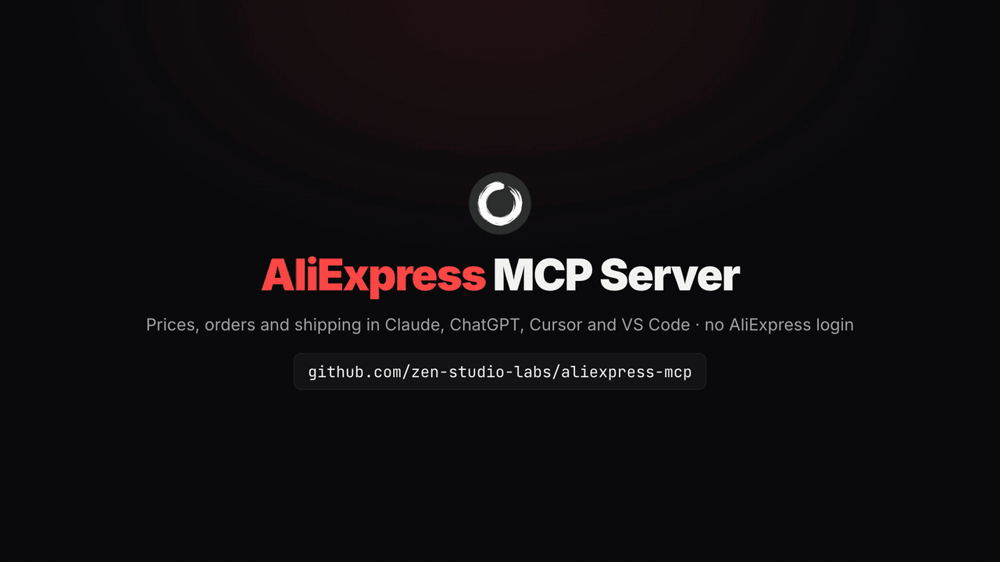
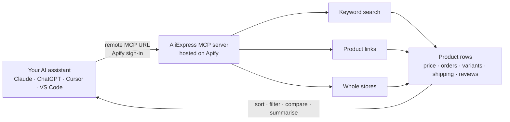

<div align="center">


# AliExpress MCP Server

**AliExpress product data inside Claude, ChatGPT, Cursor and your own code: search products, compare prices and orders, check shipping to your market, read buyer reviews. Hosted and read-only. No AliExpress login, no cookies, nothing to install.**

[](https://github.com/zen-studio-labs/aliexpress-mcp/actions/workflows/validate.yml)
[](LICENSE)



<sub>Built from a real product search run on 2 November 2026.</sub>

[](https://cursor.com/en/install-mcp?name=aliexpress&config=eyJ1cmwiOiJodHRwczovL21jcC5hcGlmeS5jb20vP3Rvb2xzPWZldGNoLWFjdG9yLWRldGFpbHMsZ2V0LWFjdG9yLXJ1bixnZXQtZGF0YXNldC1pdGVtcyx6ZW4tc3R1ZGlvL2FsaWV4cHJlc3Mtc2NyYXBlciJ9)
[](https://vscode.dev/redirect/mcp/install?name=aliexpress&config=%7B%22type%22%3A%22http%22%2C%22url%22%3A%22https%3A%2F%2Fmcp.apify.com%2F%3Ftools%3Dfetch-actor-details%2Cget-actor-run%2Cget-dataset-items%2Czen-studio%2Faliexpress-scraper%22%7D)
[](#client-setup)

[Quick start](#quick-start) · [Agent setup](#set-up-with-your-ai-agent) · [Tools](#tools) · [Prompts](#example-prompts) · [Client setup](#client-setup) · [API](#use-it-as-an-aliexpress-api) · [Pricing](#pricing) · [FAQ](#faq)

</div>

AliExpress MCP is a hosted AliExpress MCP server that connects your AI assistant to AliExpress, also written Ali Express and known in Chinese as 速卖通. Ask in plain words: your assistant searches products by keyword, opens product links you already have, or lists a whole store, and returns prices, exact order counts, ratings, every variant's price and stock, seller details, shipping options and delivery times for the country you sell to, plus buyer reviews when you want them. Results come back as structured rows it can sort, filter, compare and summarise, which is what dropshippers, product researchers and Shopify, TikTok Shop and Amazon sellers need for picking and checking products. Developers can call the same tool as an AliExpress API.

## Why AliExpress MCP

- **No AliExpress account and no app keys.** No login, no cookies, no browser extension, and no affiliate or dropshipping app to register and wait on.
- **Nothing to install.** Add one URL and sign in with Apify. Works in claude.ai and ChatGPT too, not only in desktop apps.
- **Any market, per request.** 63 delivery countries, 44 currencies and 17 languages. The country changes the catalogue, prices, VAT and delivery times, so you see what your buyers see.
- **The numbers that decide a product.** Exact order counts (not only "10,000+ sold"), rating and review count, discount, every variant with its own price and stock, seller feedback, and each shipping option with cost, delivery window and measured delivery times.
- **Three ways in.** Keyword search with sort and filters, product links for tracking known items, and whole stores for checking a supplier or a competitor.
- **Made for assistants.** A bundled skill teaches your assistant the inputs that work, how to set the market and how to read the results, and long requests keep running while it checks back.
- **Pay per result.** Plus a small start fee per run, billed to your own Apify account. No subscription; try it on Apify's free plan.

| | AliExpress MCP | Typical self-hosted AliExpress tools |
|---|---|---|
| AliExpress account, cookies or browser extension | Not needed | Often required |
| App key, secret and approval | Not needed | Required by API wrappers |
| Setup | One URL and an Apify sign-in | Python or Docker, a headless browser, environment variables |
| Market | Any of 63 countries, with currency and language, per request | One market fixed in settings |
| Web assistants (claude.ai, ChatGPT) | Supported | Usually desktop clients only |
| When AliExpress changes | Updated for you | Wait for a fix, or fix it yourself |
| Exact orders, variants with stock, shipping per market, reviews | Included | Varies, often prices only |
| Cost | Pay per result | Free software, your own machine and time |

## How it works



Each request starts a run on your Apify account. Your assistant waits for it, reads the rows, and answers in plain language. Go deeper in a second request: search a niche, then pass the best products' links back with reviews turned on, or open the store behind a strong seller.

## Quick start

1. **Create a free [Apify account](https://console.apify.com/sign-up)** if you do not have one.
2. **Add the server to your assistant.** Click a button above, or follow the steps for your client below.
3. **Sign in with Apify when your assistant asks**, then ask a question such as *"Find phone stands under $5 on AliExpress with four stars and up, most orders first, and show price, orders and shipping to the US."*

**About the Apify sign-in page.** Apify notes that your assistant "was registered dynamically and wasn't verified by Apify" and asks for full API access. Every assistant that signs in this way sees that notice; it lets your assistant start runs on your account. You can remove the access at any time on your [Apify Console integrations page](https://console.apify.com/settings/integrations).

Server URL, for any client that accepts a remote MCP server:

```text
https://mcp.apify.com/?tools=fetch-actor-details,get-actor-run,get-dataset-items,zen-studio/aliexpress-scraper
```

## Set up with your AI agent

Paste this repository's URL into Claude Code, Codex, Cursor or another agent and ask it to set up AliExpress. The steps below are written so your agent can follow them.

**For AI agents installing this server:**

1. This is a hosted remote MCP server (streamable HTTP). There is nothing to download or build. It needs a free Apify account and an Apify sign-in (OAuth) in the user's browser; do not ask for an API token unless the sign-in fails.
2. Server name `aliexpress`, server URL:
   ```text
   https://mcp.apify.com/?tools=fetch-actor-details,get-actor-run,get-dataset-items,zen-studio/aliexpress-scraper
   ```
3. Add it with the client's own command:
   - Claude Code: `claude plugin marketplace add zen-studio-labs/aliexpress-mcp`, then `claude plugin install aliexpress@aliexpress-mcp` (adds the server and the AliExpress skill).
   - Codex: `codex mcp add aliexpress --url "<server URL>"`, then `codex mcp login aliexpress`.
   - VS Code: `code --add-mcp '{"name":"aliexpress","type":"http","url":"<server URL>"}'`.
   - Cursor and other clients: add `{"mcpServers": {"aliexpress": {"url": "<server URL>"}}}` to the client's MCP config file (Cursor: `~/.cursor/mcp.json`).
4. Ask the user to complete the sign-in. In Claude Code they run `/mcp`, select aliexpress and choose **Authenticate**; other clients open the Apify sign-in page themselves. A client restart may be needed before the tools appear.
5. Check it works without starting a paid run: call `fetch-actor-details` for `zen-studio/aliexpress-scraper` and confirm it returns the input reference. The first real request is the user's own; keep it small (for example `"maxResults": 5`).
6. Before real requests, read the [AliExpress skill](skills/aliexpress/SKILL.md): it explains how long runs work, how to set the market and which inputs return good results.

## Tools

| Tool | What you get | Store page |
|---|---|---|
| Product search | Products for any keyword with price, discount, exact orders, rating, review count, AliExpress Choice and sponsored flags, ship-from country and image. Sort by best match, most orders or price; filter by price range, four stars and up, free shipping, Choice, local warehouse, ship-from country or category. Up to about 3,590 products per keyword. | [aliexpress-scraper](https://apify.com/zen-studio/aliexpress-scraper) |
| Product links | The same record for products you already know, from product links, app share links or product IDs. The way to track price and stock on a fixed list. | [aliexpress-scraper](https://apify.com/zen-studio/aliexpress-scraper) |
| Store catalogue | Every product a seller lists, from a store link or store number, optionally narrowed by a search term inside the store. About 4,800 products per store. | [aliexpress-scraper](https://apify.com/zen-studio/aliexpress-scraper) |
| Full details and shipping | On by default: every variant with its own price and stock, specifications, seller feedback and store details, coupons, and each shipping option for your market with cost, delivery window and measured delivery times. Optionally the seller's full description. | [aliexpress-scraper](https://apify.com/zen-studio/aliexpress-scraper) |
| Buyer reviews | Optional: rating, text with a translation into your language, date, buyer country, the variant bought and photos, plus the star breakdown and the review themes AliExpress shows. Up to 5,000 per product; filter to reviews with photos or from your own country. | [aliexpress-scraper](https://apify.com/zen-studio/aliexpress-scraper) |

All five are one tool, `aliexpress-scraper`; your assistant picks the inputs, and one run can mix keywords, product links and stores. The tool is read-only. It never orders, adds to cart, messages sellers or posts reviews.

<details>
<summary><b>Key fields per tool</b></summary>

| Tool | Key fields |
|---|---|
| Product search | `productId`, `title`, `url`, `price`, `priceFormatted`, `currency`, `originalPrice`, `discountPercent`, `soldCount` (exact), `soldText` (as shown), `rating`, `reviewCount`, `isChoice`, `isAd`, `shipsFrom`, `image`, `searchKeyword`, `postCategoryId` |
| Product links | `productId`, `url`, `available`, `availabilityNote`, and from the full details: `title`, `price`, `priceFormatted`, `originalPrice`, `currency`, `discountPercent`, `rating`, `reviewCount`, `soldText`, `isChoice`, `categoryPath`, plus everything in Full details and shipping. No exact `soldCount`, image thumbnail, `shipsFrom`, sponsored flag or search category ID |
| Store catalogue | `productId`, `title`, `url`, `price`, `priceFormatted`, `currency`, `originalPrice`, `discountPercent`, `soldCount`, `soldText`, `rating`, `reviewCount`, `image`, `images`, `categoryPath`, `storeNumber`, `sellerId`. With full details on, also `isChoice` and the detail fields. No `isAd`, `shipsFrom`, `searchKeyword` or `postCategoryId` |
| Full details and shipping | `variants[]` (`price`, `stock`, `options`, `salable`), `variantOptions`, `totalInventory`, `specifications`, `seller.name`, `seller.storeUrl`, `seller.positiveFeedbackRate`, `seller.feedbackScore`, `seller.country`, `seller.openedAt`, `coupons`, `buyerProtections`, `deliveryDaysMin`, `deliveryDaysMax`, `shipping[]` (`shipFrom`, `shipTo`, `cost`, `costFormatted`, `isFree`, `deliveryDaysMin`, `deliveryDaysMax`, `estimatedDeliveryFrom`, `estimatedDeliveryTo`, `tracked`, `deliveryDistribution`) |
| Buyer reviews | `reviews[]` (`rating`, `text`, `textOriginal`, `date`, `buyerCountry`, `skuInfo`, `images`, `wouldBuyAgain`), `reviewStatistics` (star counts and rates), `reviewImpressions` (themes with sentiment and count) |

The Store page lists every field.

</details>

## Example prompts

**Dropshipping product research**
- *Find the 30 best-selling LED strip lights on AliExpress under $10 with four stars and up, and rank them by orders per review.*
- *Which pet hair removers on AliExpress have the most orders? Show price, orders, rating and the store selling each.*

**Price and stock tracking**
- *Check today's price and stock for each variant of these products: https://www.aliexpress.com/item/1005006439988253.html*
- *Compare the price of this product in the US, Germany and Brazil, each in its local currency.*

**Suppliers and competitors**
- *List every product in this store with price and orders, top sellers first: https://www.aliexpress.com/store/1105246100*
- *For the top five sellers of magnetic phone holders, compare store feedback, positive rate and years open.*

**Shipping and local warehouses**
- *Find phone cases that ship from a US warehouse and arrive within 7 days, and show the shipping cost.*
- *Which of these products ship free to the UK, and how long does delivery take?*

**Buyer reviews**
- *Read 100 reviews with photos for this product and list the complaints that come up most.*
- *Summarise what buyers in France say about this product, in English.*

**Other markets and languages**
- *Busca soportes para móvil en AliExpress España por menos de 5 €, ordenados por pedidos, con precios en euros.*
- *Procure suportes de celular no AliExpress Brasil até R$ 30, com preço em reais e prazo de entrega.*

Tip: name the country you sell to. Your assistant then sets the matching market, currency and language, because a product's price, VAT and delivery time differ by country.

## Client setup

<details open>
<summary><b>Claude (claude.ai and Claude Desktop)</b></summary>

1. Open **Settings** > **Connectors** and select **Add custom connector**.
2. Name it `AliExpress` and paste the server URL above.
3. Select **Connect** and sign in with Apify.
4. In a chat, enable the AliExpress connector from the tools menu.

The connector syncs between claude.ai and Claude Desktop. Custom connector availability depends on your Claude plan. For better results, also add the [AliExpress skill](skills/aliexpress/SKILL.md): download [aliexpress-skill.zip](https://github.com/zen-studio-labs/aliexpress-mcp/releases/latest/download/aliexpress-skill.zip) and upload it under **Skills** in Claude's settings.

</details>

<details>
<summary><b>Claude Code</b></summary>

Plugin (server plus the AliExpress skill, recommended):

```text
/plugin marketplace add zen-studio-labs/aliexpress-mcp
/plugin install aliexpress@aliexpress-mcp
```

Server only:

```bash
claude mcp add --transport http aliexpress "https://mcp.apify.com/?tools=fetch-actor-details,get-actor-run,get-dataset-items,zen-studio/aliexpress-scraper"
```

Then sign in: run `/mcp`, select the aliexpress server and choose **Authenticate**. Until you do, `/mcp` lists the server as not authenticated and may say its tools could not be fetched; both clear once you sign in.

</details>

<details>
<summary><b>Cursor</b></summary>

Click **Install in Cursor** above, or add [`examples/cursor-mcp.json`](examples/cursor-mcp.json) to `~/.cursor/mcp.json` (all projects) or `.cursor/mcp.json` (one project). Cursor asks you to sign in with Apify on first use.

</details>

<details>
<summary><b>VS Code and GitHub Copilot</b></summary>

Click **Install in VS Code** above ([VS Code Insiders](https://insiders.vscode.dev/redirect/mcp/install?name=aliexpress&config=%7B%22type%22%3A%22http%22%2C%22url%22%3A%22https%3A%2F%2Fmcp.apify.com%2F%3Ftools%3Dfetch-actor-details%2Cget-actor-run%2Cget-dataset-items%2Czen-studio%2Faliexpress-scraper%22%7D&quality=insiders)), or add [`examples/vscode-mcp.json`](examples/vscode-mcp.json) to `.vscode/mcp.json`. Start the server from the MCP view and sign in with Apify when prompted. Use the tools in Copilot Chat agent mode.

</details>

<details>
<summary><b>ChatGPT</b></summary>

1. Open [ChatGPT Plugins](https://chatgpt.com/plugins), select **+**, then **Add custom MCP server**.
2. Name it `AliExpress`, paste the server URL above, and choose **OAuth** authentication.
3. Confirm, create the plugin, and sign in with Apify.
4. In a new chat, type `@` and select **AliExpress**.

Business, Enterprise and Edu workspaces may need an admin to enable custom servers. See OpenAI's [custom MCP server guide](https://help.openai.com/en/articles/12584461-connecting-custom-mcp-servers-in-chatgpt).

</details>

<details>
<summary><b>Codex</b></summary>

```bash
codex mcp add aliexpress --url "https://mcp.apify.com/?tools=fetch-actor-details,get-actor-run,get-dataset-items,zen-studio/aliexpress-scraper"
codex mcp login aliexpress
```

Or copy [`examples/codex-config.toml`](examples/codex-config.toml) into `~/.codex/config.toml`.

</details>

<details>
<summary><b>Other clients, or a token instead of sign-in</b></summary>

Most clients that support remote MCP servers accept:

```json
{
  "mcpServers": {
    "aliexpress": {
      "url": "https://mcp.apify.com/?tools=fetch-actor-details,get-actor-run,get-dataset-items,zen-studio/aliexpress-scraper"
    }
  }
}
```

If your client cannot complete the Apify sign-in, send your Apify token as a header instead, see [`examples/bearer-token-mcp.json`](examples/bearer-token-mcp.json). Copy the token from your [Apify Console integrations page](https://console.apify.com/settings/integrations) and keep it out of shared files. Clients that only run local servers can bridge with `mcp-remote`, see [`examples/claude-desktop-config.json`](examples/claude-desktop-config.json).

</details>

## Use it as an AliExpress API

The tool is also an [Apify Actor](https://apify.com/zen-studio) with a REST API, so you can call it from your own code, a pipeline or an automation, without an assistant. Copy your API token from the [Apify Console integrations page](https://console.apify.com/settings/integrations). The input fields are the same ones the assistant uses; the Store page has an **API** tab with ready-made code and the full input reference.

<details open>
<summary><b>Python</b></summary>

```bash
pip install apify-client
```

```python
import os
from apify_client import ApifyClient

client = ApifyClient(os.environ["APIFY_TOKEN"])
run = client.actor("zen-studio/aliexpress-scraper").call(
    run_input={"keywords": ["phone stand"], "maxResults": 20, "sort": "orders", "priceMax": 5,
               "country": "US", "currency": "USD", "language": "en_US"}
)
for item in client.dataset(run["defaultDatasetId"]).iterate_items():
    print(item["price"], item.get("soldCount"), item["rating"], item["title"], item["url"])
```

</details>

<details>
<summary><b>JavaScript and TypeScript</b></summary>

```bash
npm install apify-client
```

```js
import { ApifyClient } from 'apify-client';

const client = new ApifyClient({ token: process.env.APIFY_TOKEN });
const run = await client.actor('zen-studio/aliexpress-scraper').call({
    keywords: ['phone stand'],
    maxResults: 20,
    sort: 'orders',
    priceMax: 5,
    country: 'US',
    currency: 'USD',
    language: 'en_US',
});
const { items } = await client.dataset(run.defaultDatasetId).listItems();
console.log(items);
```

</details>

<details>
<summary><b>HTTP</b></summary>

Start a run and get its results in one request:

```bash
curl -X POST "https://api.apify.com/v2/acts/zen-studio~aliexpress-scraper/run-sync-get-dataset-items" \
  -H "Authorization: Bearer $APIFY_TOKEN" \
  -H "Content-Type: application/json" \
  -d '{"keywords": ["phone stand"], "maxResults": 20, "sort": "orders", "priceMax": 5}'
```

This waits up to 300 seconds. For bigger runs, start the run asynchronously and read its dataset when it finishes, see the [Apify API reference](https://docs.apify.com/api/v2/act-run-sync-get-dataset-items-post).

</details>

<details>
<summary><b>n8n, Make and Zapier</b></summary>

Use Apify's integration for [n8n](https://docs.apify.com/platform/integrations/n8n), [Make](https://docs.apify.com/platform/integrations/make) or [Zapier](https://docs.apify.com/platform/integrations/zapier), choose the Actor `zen-studio/aliexpress-scraper` and pass the same JSON input. A daily schedule on a list of product links is the usual setup for price and stock tracking.

</details>

## Use cases

- **Dropshipping product research.** Best sellers in a niche by exact orders, with price, rating, reviews and delivery time side by side.
- **Price and stock tracking.** Re-check a fixed list of products, variant by variant, on a schedule.
- **Supplier and competitor checks.** A seller's whole range with prices and orders, plus store feedback and years open.
- **Shipping research.** Which products ship from a local warehouse, what shipping costs, and how often orders arrive within a given number of days.
- **Review mining.** Recurring complaints and praise, photos, and the variants buyers chose, before you list a product.
- **Market comparison.** The same search in the US, Germany, Brazil or Japan, each in its own currency and language.

## Example output

One product search row from the run in the demo, abridged. Your assistant reads rows like this and answers in plain language.

```json
{
  "productId": "3256813069085205",
  "title": "Metal Magnetic Phone Holder Mini Round Car Magnet Mount Universal Stick on Dashboard Magnetic Stand for Smartphone Navigation",
  "url": "https://www.aliexpress.com/item/3256813069085205.html",
  "price": 1.09,
  "priceFormatted": "US $1.09",
  "currency": "USD",
  "originalPrice": 8.41,
  "discountPercent": 87,
  "soldCount": 155062,
  "soldText": "100K+ sold",
  "rating": 4.9,
  "reviewCount": 16106,
  "isChoice": true,
  "shipsFrom": "CN",
  "variantCount": 23,
  "seller": { "name": "Stone's Store", "positiveFeedbackRate": "100.0" },
  "shipping": [
    {
      "shipFrom": "China",
      "shipTo": "United States",
      "cost": 0,
      "costFormatted": "Free",
      "isFree": true,
      "deliveryDaysMin": 8,
      "deliveryDaysMax": 14,
      "estimatedDeliveryFrom": "2026-11-10",
      "estimatedDeliveryTo": "2026-11-16",
      "tracked": true,
      "deliveryDistribution": { "summary": "83.2% orders arrive in ≤ 13 days" }
    }
  ]
}
```

## How long requests work

Each tool call returns within about 45 seconds. Bigger requests keep running on Apify after that, and your assistant checks back until the results are ready, then reads them in pages. You may see a few "still running" updates; that is expected. Twenty products with full details took about 50 seconds in the demo run; reviews and long product lists take longer. The [AliExpress skill](skills/aliexpress/SKILL.md) teaches assistants this flow, along with input recipes for each job. Claude Code gets it with the plugin.

## Pricing

Pay per result plus a small start fee per run, billed to your Apify account. There is no subscription to this repository. Each product is billed, the full details add-on (on by default) is billed per product, and buyer reviews are billed per review. Current prices, including volume discounts, are on the tool's pricing page:

- [AliExpress product search, links and stores](https://apify.com/zen-studio/aliexpress-scraper/pricing)

Your assistant controls cost through `maxResults`, `maxReviewsPerProduct` and the details add-on. Ask for a small number first, then scale up.

**Free Apify plan:** every run returns up to 62 products, including runs set to no limit. The tool does not limit the number of runs; each run is billed against your plan's monthly credit like any other. Any paid Apify plan removes the 62-product cap.

## Limitations

- **One market per run.** Country, currency and language apply to the whole run; compare markets with one run each.
- **Search depth.** About 3,590 products per keyword and about 4,800 per store. Add more specific keywords, filters or a search term inside the store to go further.
- **Exact order counts come with search and store results.** Products added by link show the order label ("10,000+ sold") instead.
- **Markets.** 63 delivery countries are available; Russia and Kazakhstan are not among them.
- **No business licence details.** Seller rows carry store name, number, feedback and sales volume, not registered company documents.
- **Read-only.** No orders, carts, messages or reviews.

Use the data responsibly and in line with AliExpress's terms and the data protection laws that apply to you, such as GDPR, CCPA and PIPL. Reviews can carry a buyer's display name and country; most display names are anonymous ("AliExpress Shopper").

## Troubleshooting

- **`/mcp` says the server is not authenticated, or its tools could not be fetched.** Select the server and choose **Authenticate**. Other clients show a **Connect** or **Sign in** button.
- **Prices or delivery times differ from what you see on AliExpress.** Set country, currency and language together for the market you check; currency and language do not follow the country by themselves.
- **A search returns few products.** Price ranges, filters and ship-from countries narrow fast. Widen the price range, drop a filter, or try a broader keyword.
- **A run stopped at 62 products.** That is the free Apify plan. Any paid plan removes it.
- **Your assistant says a run is still going.** That is normal for bigger requests and for reviews. Ask it to keep checking the same run; a new request for the same question is billed again.
- **A product link returns nothing.** Use the full product address, such as `aliexpress.com/item/1005006439988253.html`. Shortened share links from the app can expire.
- **Your client cannot complete the sign-in.** Use an Apify token header instead, see [Other clients](#client-setup).

## FAQ

**What is AliExpress?**
AliExpress (速卖通, in full 全球速卖通) is Alibaba Group's global consumer marketplace, where mostly Chinese sellers ship directly to buyers worldwide. It is a common supplier for dropshipping stores on Shopify, TikTok Shop and other platforms.

**Is there an AliExpress API?**
Yes. This tool can be called over a REST API or with Apify's Python and JavaScript clients, see [Use it as an AliExpress API](#use-it-as-an-aliexpress-api). AliExpress's own affiliate and dropshipping programs give API access after you register an app and wait for approval; this needs neither.

**How is this different from open-source AliExpress MCP servers?**
Open-source servers run on your machine with Python or Docker, and most need your logged-in AliExpress session, a browser extension or affiliate app keys, with one market fixed in settings. AliExpress MCP is hosted: no AliExpress account, no keys, nothing to run, any market per request, and it works in web assistants such as claude.ai and ChatGPT.

**Do I need an AliExpress account?**
No. You only need an Apify account, which takes a minute to create.

**Is it free?**
You can try it on Apify's free plan. Results are billed from the first run against the plan's monthly credit, and on the free plan every run returns at most 62 products. The tool sets no limit on the number of runs; your Apify credit does. See [Pricing](#pricing).

**Can it place orders, post reviews or message sellers?**
No. The tool is read-only by design.

**Which countries and currencies are supported?**
63 delivery countries, 44 currencies and 17 languages. Your assistant sets all three for the market you name.

**Is the data live?**
Yes. Prices, stock, delivery estimates and review counts reflect AliExpress at the moment you ask, in the market you chose.

**Does it work with Shopify or DSers?**
It researches products; it does not import them into your store. Export rows as JSON or CSV from Apify, or connect your store tools through n8n, Make or Zapier.

**Which AI assistants work with it?**
Any client that supports remote MCP servers, including Claude (claude.ai, Claude Desktop, Claude Code), ChatGPT, Codex, Cursor, VS Code with GitHub Copilot and many more.

**Is this an official AliExpress product?**
No. AliExpress MCP is an independent product by Zen Studio and is not affiliated with AliExpress or Alibaba Group.

## Privacy

Requests go to Apify's hosted MCP server and run on your Apify account. Apify's [privacy policy](https://docs.apify.com/legal/privacy-policy) applies. This repository contains configuration and instructions only; it collects nothing.

## More from Zen Studio

AliExpress MCP is built on [Zen Studio's Apify Actors](https://apify.com/zen-studio). You can also run the tool directly on Apify, from its API, or on a schedule. For Xianyu (闲鱼) second-hand listings, see [Goofish MCP](https://github.com/zen-studio-labs/goofish-mcp). For Xiaohongshu (小红书) notes, comments and creators, see [RedNote MCP](https://github.com/zen-studio-labs/rednote-xiaohongshu-mcp).

## License

[MIT](LICENSE). AliExpress and 速卖通 are trademarks of their respective owners.
